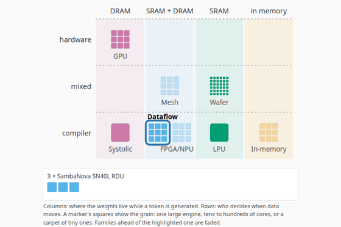
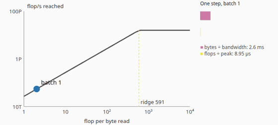
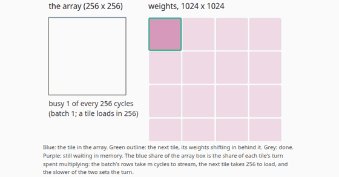
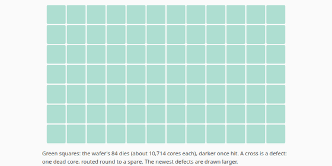
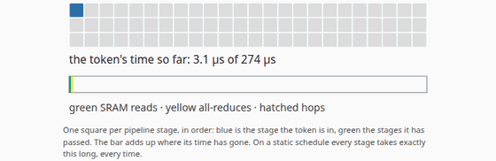

# AI Accelerators Explained

An animated explainer of the families of AI silicon, each run on the same
work: a Llama decoder's prefill and decode steps. For every family the
question is the same: **where do the weights and activations live, what
moves on each step, and who decides when it moves** (the hardware at run
time, or the compiler ahead of time)? GPUs are the baseline; then systolic
designs (Google TPU, AWS Trainium), wafer-scale engines (Cerebras) and
compiler-scheduled SRAM-only chips (Groq's LPU), with reconfigurable
dataflow, meshes of small cores, FPGAs and edge NPUs, and in-memory compute to
follow. Every chapter is built around an animation, every frame of every
animation is computed by a small **accelerator model** whose TypeScript port
matches its Python reference exactly, and every specification carries its
source and the date it was read.

It sits in the companion sites' **Hardware** track ("the machines
underneath, chip to rack"), beside
[GPU Kernels Explained](https://gpu-kernels-explained.vercel.app/) (how a GPU
executes the maths),
[Systolic Arrays Explained](https://systolic-arrays-explained.vercel.app/)
(inside a matrix engine) and
[AI Racks Explained](https://ai-racks-explained.vercel.app/) (the machines
these chips go into). Chapters link the chapters of those sites and of
[Numerics Explained](https://numerics-explained.vercel.app/) that they build
on, and the slides of the
[NVIDIA GPU](https://brendanjameslynskey.github.io/LLM_Hub_NVIDIA_GPUs/) and
[Google TPU](https://brendanjameslynskey.github.io/LLM_Hub_Google_TPUs/)
series.

**Live:** [ai-accelerators-explained.vercel.app](https://ai-accelerators-explained.vercel.app/)

## Part of

This repository is brief 37 of a programme of companion sites. Part A (this
state) builds the model, the sourced data and chapters 1–5; part B adds
chapters 6–10 (dataflow, meshes, FPGAs and NPUs, in-memory compute, and a
side-by-side comparison) and the deck and hub links; part C adds Accelerators
to the shared site switch (Hardware = Kernels · Systolic · Accelerators ·
Racks). Until then the header names the site itself and relabels the switch's
button "Hardware › Accelerators" (see `src/components/ui/SiteHeader.tsx`),
because `SiteSwitch.tsx` must stay byte-identical on every site.

## Chapters

| #   | Chapter                                                                                              | The animation                                                                                                                              |
| --- | ---------------------------------------------------------------------------------------------------- | ------------------------------------------------------------------------------------------------------------------------------------------ |
| 1   | [The design space](https://ai-accelerators-explained.vercel.app/learn/01-the-design-space)           | The families on a map (where the weights live × who schedules), stepping through each, with the chips each needs to hold the running model |
| 2   | [GPUs: the baseline](https://ai-accelerators-explained.vercel.app/learn/02-gpus-the-baseline)        | One decode step on H100s or B200s climbing the roofline as the batch grows, with its memory and compute terms                              |
| 3   | [Systolic designs](https://ai-accelerators-explained.vercel.app/learn/03-systolic-designs)           | A matmul tile by tile on a 256 × 256 (TPU) or 128 × 128 (Trainium2) array, and how little of it a small batch uses                         |
| 4   | [Wafer-scale](https://ai-accelerators-explained.vercel.app/learn/04-wafer-scale)                     | Defects landing on a wafer of 84 dies, each killing one core that a spare replaces, against a reticle-sized die's yield                    |
| 5   | [Compiler-scheduled chips](https://ai-accelerators-explained.vercel.app/learn/05-compiler-scheduled) | One token down a chain of SRAM-only chips on a static schedule: SRAM reads, all-reduces and hops                                           |

### The hero animations

Recorded frame by frame from the model's states (`pnpm animations`); WebM
versions sit beside them in [`docs/media/`](docs/media/).

| The map                    | GPU roofline                         | Systolic tiles             |
| -------------------------- | ------------------------------------ | -------------------------- |
|  |  |  |

| Wafer defects                  | A chain of LPUs                |
| ------------------------------ | ------------------------------ |
|  |  |

## The model

[`accel_model/`](accel_model/) is a **teaching model**, not a simulator of
any product. [`data.py`](accel_model/data.py) holds the sourced data and
[`core.py`](accel_model/core.py) its closed forms:

- **placement** (`placement`): weights plus the KV cache in the part's main
  memory (HBM when it has some, SRAM when it has none), and the fewest chips
  that hold them;
- **decode and prefill bounds** (`decode`, `prefill`, `ridge`,
  `throughput_ceiling`): the larger of bytes over bandwidth and flops over
  the peak rate, plus the chip-to-chip latency the layout forces where the
  vendor gives it. GPUs and systolic chips use a tensor layout (every chip
  works on every layer); wafers and LPUs a pipeline cut at layer boundaries
  into stages of `group` chips, where one token's time is the sum of the
  stages' plus a hop between each;
- **the map** (`family_map`, `map_steps`) and **the batch sweep**
  (`batch_sweep`, `max_batch`);
- **systolic tiles** (`mxu`, `layer_mxu`, `mxu_steps`): a weight-stationary
  array working tile after tile with the next tile's weights loading behind;
- **wafer-scale** (`wafer_yield`, `defects`, `defect_steps`,
  `wafers_needed`): Poisson defects, a reticle-sized die's yield, spares, and
  weight streaming over the system's I/O;
- **chains** (`chain_steps`, `lpu_capacity`): one token through a pipeline of
  SRAM-only chips;
- **validation** (`validation`, `band`, `implied_overhead`).

### Sources and statuses

Every figure is a field `{v, st, src, ref}`: its value, a status (`spec`,
`derived`, `reported`, `illustrative`, `undisclosed`), a source id and where
in the source it is; every source records the date it was read
(2026-10-15). Parts carry an availability: `product`, `announced` (the
CS-4's WSE-3 Turbo, the Groq 3 LPU) or `retired` (the first-generation
GroqChip, kept because published results used it). Where the sources used do
not give a figure (Cerebras's dense rate, TPU and Trainium power, NVLink and
ICI latency), the model stores `null` and the site prints "not disclosed".
Vendor claims are quoted in `CLAIMS` and never used as inputs.
[`scripts/make_fixtures.py`](scripts/make_fixtures.py) writes the whole table,
the numbers the chapters use and the validation band to
[`results.md`](results.md); the site shows the same on
[/specs](https://ai-accelerators-explained.vercel.app/specs).

### Validation band

Seven published figures the model does not take as inputs, in three kinds
([results.md](results.md#validation-band)):

- **Capacity** (3 checks, ratio 1.0 to 1.91): Cerebras's "as few as four
  systems" for a 16-bit 70B model and one for 20B match exactly; Groq's
  Llama 2 70B demonstration used 576 chips, 1.91 times the model's minimum of
  301, which is a floor (no room for activations, and whole nodes).
- **Throughput** (1 check, 0.19): MLPerf Inference v4.0, eight H100s on
  Llama 2 70B Offline, against the compute ceiling for output tokens.
- **Latency** (3 checks, 0.0013 to 0.082): one user's tokens per second on
  SRAM designs (Groq, Cerebras) against the bandwidth bound. This is where
  the model misses, and the chapters say so: once the weights are in SRAM,
  bandwidth is not what limits one user. The published speeds imply 17 to
  38 µs per layer beyond the bound, which the sources do not break down.

### What is illustrative

- Chapter 4's defect density (0.1 per cm²), its share of spare cores (1.5%)
  and the 12 × 7 drawing of the wafer's 84 dies.
- Chip counts are capacity only (weights plus the KV cache).
- Bounds assume the full stated bandwidth and the dense peak; where Cerebras
  gives only a sparse figure, compute terms from it are marked sparse.
- Chapter 5 charges one hop of Groq's measured 722 ns for every hand-on and
  every all-reduce inside a stage; the Groq 3 chain has no hop time because
  the latency is not disclosed.
- Energy per token for the B200 and the CS-3 uses a system share of stated
  system power, not a chip figure.

### Checked

- `tests/python/test_accel_model.py` (pytest): every field has a known
  source, status and date, every source is cited, the parameter counts, the
  placement, decode, tile, defect and chain models, and the validation
  checks.
- Exact parity: the TypeScript port
  ([`src/lib/accel/model.ts`](src/lib/accel/model.ts)) must reproduce every
  fixture value exactly (`tests/unit/model.test.ts`; the two exponentials of
  the yield model to 1e-12); CI fails if the fixtures, `src/data/accel.json`
  or `results.md` are out of date.
- Frame tests: key frames of every animation equal the reference's states,
  and the captions built from them are what the page shows (unit and e2e).
- Numbers in the prose are printed from the model at build time
  (`<V of="…" />`, including model calls such as
  `decode(h100,llama3-70b,fp8,1,1024,8).t_step`); `tests/unit/values.test.ts`
  checks every path resolves.

## The animations

Every animation follows the family's visual standard: play and pause, step
back and forward, a scrub bar, speed from 0.25× to 4× and reset; Space and the
arrow keys when it has focus; a live caption per step, also in an
`aria-live` region; no auto-play with `prefers-reduced-motion`; paused when
scrolled out of view; the equation beside the picture, with the term the
animation is on highlighted. Colours are Okabe and Ito's colour-blind-safe
palette, the same in light and dark mode: off-chip memory (HBM) purple as on
every companion site, on-chip SRAM green, tiered memory sky blue, compute in
the memory array orange, compute yellow; waiting (a hop) is a warning hue
**and** a hatch. On phones every SVG label renders at 11 px or more.

## Stack

The same stack as the companion sites: Next.js 14 (App Router) and
TypeScript (strict), Tailwind CSS, MDX via `next-mdx-remote` with KaTeX
rendered on the server, a Python reference with a TypeScript port and JSON
fixtures; pytest, Vitest and Playwright (every page at 1280 and 390 px, light
and dark; every animation's controls; frame tests; reduced motion; axe-core);
GitHub Actions (model and fixtures, lint, typecheck, unit, e2e, Lighthouse);
Vercel. No database and no sign-in: every page is static.

### Design system: where each piece came from

Copied from [ai-racks-explained](https://github.com/BrendanJamesLynskey/ai-racks-explained)
at commit `c493a2b`:

| Here                                                                                                           | From                                                                                                       |
| -------------------------------------------------------------------------------------------------------------- | ---------------------------------------------------------------------------------------------------------- |
| `tailwind.config.ts`, `src/app/layout.tsx`, `src/app/learn/`, `src/lib/mdx/`, `Layer*.tsx`, `MdxTable.tsx`     | identical apart from titles and chapters                                                                   |
| `src/components/ui/SiteSwitch.tsx`                                                                             | **byte-identical** to every companion site (sha256 `5b2d9873…`); it has no Accelerators entry until part C |
| `src/components/ui/SiteHeader.tsx`                                                                             | the brand from `SITE_NAME`, and the switch relabelled in CSS until part C                                  |
| `src/components/anim/`, `src/lib/anim/`, `Controls.tsx`, `Callout.tsx`, `Eq.tsx`, `useSvgFont.ts`, `Hatch.tsx` | unchanged                                                                                                  |
| `src/app/globals.css`, `src/lib/viz/palette.ts`                                                                | placement and time-term colours (`PLACEMENT_COLOUR`, `TERM_COLOUR`) and their equation highlights          |
| CI, Playwright, Vitest and Lighthouse configs, `scripts/`, `RUNBOOK.md`                                        | adapted (new model, pages and chapters)                                                                    |

New here: the accelerator model and its port, the sourced tables
(`src/components/mdx/Tables.tsx`), `/specs`, and the five widgets.

## Local development

```bash
git clone https://github.com/BrendanJamesLynskey/ai-accelerators-explained
cd ai-accelerators-explained
pnpm install
python3 -m venv .venv && .venv/bin/pip install -r accel_model/requirements.txt
pnpm dev                              # http://localhost:3000
```

## Changing the model

```bash
# edit accel_model/, then the same change in src/lib/accel/model.ts
.venv/bin/python -m pytest tests/python      # the reference's checks
.venv/bin/python scripts/make_fixtures.py    # regenerate src/data, the fixtures and results.md
pnpm test                                    # the port must match exactly
```

## Testing

```bash
.venv/bin/python -m pytest tests/python
pnpm lint && pnpm typecheck && pnpm format:check
pnpm test:coverage
pnpm test:e2e
pnpm lighthouse
pnpm smoke <url>
```

## Deploying

See [`RUNBOOK.md`](RUNBOOK.md): a CLI deploy from a clean `git archive`
export, then `pnpm smoke`.

## Project layout

```
content/chapters/     The MDX chapters, each opening with its animation
accel_model/          The Python accelerator model: data.py (sources, parts, families), core.py (closed forms)
scripts/              make_fixtures, smoke-check, capture-screenshots, capture-animations
src/app/              Routes: /, /learn, /learn/[slug], /specs, /about
src/lib/accel/        The TypeScript model, the captions, the values the prose quotes
src/data/             Specifications and sources (make_fixtures.py)
src/components/       Animation panel, widgets, tables, figures
tests/python/         pytest
tests/unit/           Vitest (fixtures in tests/fixtures/)
tests/e2e/            Playwright + axe-core
results.md            Every figure with its source and date, chapter numbers, validation band
```

## References

- GPUs: NVIDIA, [H100](https://www.nvidia.com/en-us/data-center/h100/), [HGX](https://www.nvidia.com/en-us/data-center/hgx/), [DGX B200](https://www.nvidia.com/en-us/data-center/dgx-b200/), [Hopper in depth](https://developer.nvidia.com/blog/nvidia-hopper-architecture-in-depth/).
- Systolic designs: Google Cloud, [TPU architecture](https://cloud.google.com/tpu/docs/system-architecture-tpu-vm), [TPU v6e](https://cloud.google.com/tpu/docs/v6e), [TPU7x](https://cloud.google.com/tpu/docs/tpu7x); AWS Neuron, [Trainium2](https://awsdocs-neuron.readthedocs-hosted.com/en/latest/about-neuron/arch/neuron-hardware/trainium2.html), [NeuronCore-v3](https://awsdocs-neuron.readthedocs-hosted.com/en/latest/about-neuron/arch/neuron-hardware/neuron-core-v3.html).
- Wafer-scale: Cerebras, [WSE-3 Turbo](https://www.cerebras.ai/chip), [CS-4](https://www.cerebras.ai/system), [white paper](https://cdn.sanity.io/files/e4qjo92p/production/2d7fa58e3b820715664bcf42097e86c05070c161.pdf), [CS-3 datasheet](https://cdn.sanity.io/files/e4qjo92p/production/864133620041e5af418074842e42a669c137fa23.pdf), [CS-4 datasheet](https://cdn.sanity.io/files/e4qjo92p/production/bb028ae2422089dfbcc9fd2455c021f3625c7a75.pdf), [Cerebras Inference](https://www.cerebras.ai/blog/introducing-cerebras-inference-ai-at-instant-speed).
- Compiler-scheduled: Abts et al., 2022 — _A Software-defined Tensor Streaming Multiprocessor for Large-scale Machine Learning_ (ISCA; [Groq's copy, archived](https://web.archive.org/web/20250612160012/https://groq.com/wp-content/uploads/2024/02/GroqISCAPaper2022_ASoftwareDefinedTensorStreamingMultiprocessorForLargeScaleMachineLearning-1.pdf)); Groq, [GroqChip product brief](https://web.archive.org/web/20250615145238/https://groq.com/wp-content/uploads/2022/10/GroqChip%E2%84%A2-Processor-Product-Brief-v1.5.pdf); NVIDIA, [Groq 3 LPX](https://www.nvidia.com/en-us/data-center/lpx/).
- Benchmarks: MLCommons, [MLPerf Inference v4.0 results](https://github.com/mlcommons/inference_results_v4.0) and the [Llama 2 70B reference](https://github.com/mlcommons/inference/blob/master/language/llama2-70b/README.md).
- Models: Touvron et al., 2023 — _[Llama 2](https://arxiv.org/abs/2307.09288)_; Grattafiori et al., 2024 — _[The Llama 3 Herd of Models](https://arxiv.org/abs/2407.21783)_.
- The other families: Sze et al., 2017 — _[Efficient Processing of Deep Neural Networks](https://arxiv.org/abs/1703.09039)_; Prabhakar et al., 2024 — _[SambaNova SN40L](https://arxiv.org/abs/2405.07518)_; Jia et al., 2019 — _[Dissecting the Graphcore IPU](https://arxiv.org/abs/1912.03413)_; Le Gallo et al., 2023 — _[A 64-core mixed-signal in-memory compute chip](https://arxiv.org/abs/2212.02872)_.
- Okabe and Ito, 2008 — _[Color Universal Design](https://jfly.uni-koeln.de/color/)_ (the palette).

## Contributing

PRs welcome. CI runs the model job (fixtures, site data and results.md up to
date; pytest), `format:check`, `lint`, `typecheck`, unit tests with coverage
thresholds, e2e on a production build, and Lighthouse CI (performance,
accessibility and best practices must each score at least 90 on `/`,
`/specs` and every chapter).

## Licence

MIT — see [`LICENSE`](LICENSE).
